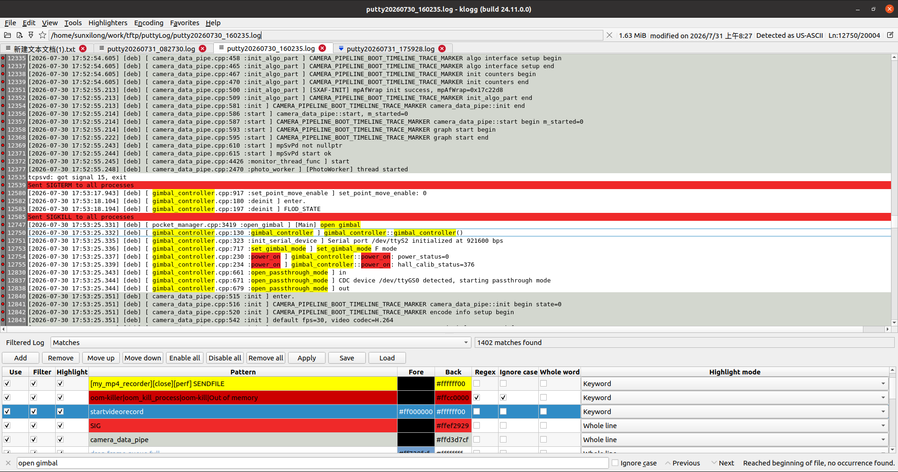

# SX Klogg

这是基于 [klogg](https://github.com/variar/klogg) 定制的日志查看工具分支。

这个分支不重复介绍 klogg 原项目本身。这里重点记录本分支针对日常检查 log 的工作流做了哪些调整，以及最终界面效果。



## 改造目标

原始 klogg 已经具备高性能大文件浏览、搜索、过滤、高亮能力，但过滤器和高亮配置比较分散，过滤后的 log 与完整 log 的查看方式也不够贴近日常排查习惯。

本分支的目标是让 klogg 更接近 TextAnalysisTool.NET 的使用方式：

- 主窗口只显示一种主体内容：`Filtered Log` 或 `Full Log`。
- 过滤后的 log 作为优先视图，用于快速定位问题点。
- 完整 log 作为同一主窗口里的另一面，用于回看上下文和避免漏掉信息。
- 底部集中展示、编辑、启用、禁用过滤器和高亮规则。
- 高亮规则和过滤器规则统一维护，避免一边加过滤器、一边再单独配置高亮。

## 主要改动

### Filtered Log / Full Log 切换

主窗口增加 `Filtered Log` / `Full Log` 切换按钮。

- `Filtered Log`：显示由底部过滤器组合得到的过滤结果。
- `Full Log`：显示完整原始 log。
- 两个视图不同时占用主体空间，避免窗口被拆得过碎。
- 支持 `Ctrl+H` 快捷键在两个视图之间切换。

### 底部过滤器面板

窗口底部新增过滤器管理面板，用于集中维护当前使用的过滤器。

每条过滤器支持：

- 启用 / 禁用
- 过滤文本
- 前景色
- 背景色
- 命中次数
- 是否使用正则表达式
- 是否大小写敏感
- 是否全词匹配
- 关键字高亮 / 全行高亮

底部面板可以通过拖动分隔条调整高度，扩大后过滤器列表会真正获得更多显示空间。

### 自动应用过滤器

过滤器发生变化后会自动应用，不再需要每次手动点击搜索框或放大镜。

会自动触发过滤的操作包括：

- 勾选 / 取消勾选过滤器
- 新增过滤器
- 删除过滤器
- 修改过滤器文本或选项
- `Enable All`
- `Disable All`
- `Remove All`
- 上移 / 下移过滤器

`Apply` 按钮仍然保留，用于需要手动重新应用时显式触发。

### 高亮与过滤器统一

每个高亮规则都可以同步作为过滤器使用。

过滤表达式会按启用的过滤器自动组合，例如：

```text
camera|sv_element|first_pixel|ret=
```

不再展示或要求用户手动维护顶部搜索框中的组合表达式。

### 过滤器保存和加载

支持将当前过滤器配置保存到文件，并从文件重新加载。

用途：

- 保存项目常用默认过滤器。
- 系统异常关闭后，通过加载文件恢复过滤器。
- 不同项目之间切换过滤器配置。

### 过滤器顺序调整

支持上移、下移过滤器。

当同一行同时命中多个过滤器时，过滤器顺序会影响最终显示效果。通过调整顺序，可以让更重要的规则优先生效。

### 横向滚动

支持 `Shift + 鼠标滚轮` 横向滚动。

横向滚动速度已调低，避免轻微滚动就移动过远。

## 当前推荐用法

1. 打开 log 文件。
2. 在底部过滤器面板中添加关注的关键字。
3. 为不同关键字设置前景色、背景色和高亮方式。
4. 默认查看 `Filtered Log` 快速定位问题。
5. 需要完整上下文时按 `Ctrl+H` 切到 `Full Log`。
6. 将常用过滤器保存为文件，后续项目中直接加载复用。

## 构建和安装

构建方式沿用 klogg 原项目。

原项目文档：

- [klogg README](https://github.com/variar/klogg)
- [klogg BUILD.md](BUILD.md)

本分支当前主要在 Ubuntu 桌面环境下验证。

## License

本项目继承 klogg 原项目许可证。详见 [COPYING](COPYING)。
